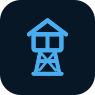

# Sal0 Tower



Painel em português para o **Watchtower que já está instalado**, no estilo Sal0 Block/Voz/Karaokê. Um único container de interface, separado do atualizador, com temas escuro/claro e tela adaptada ao celular.

## Instalação no ZimaOS/CasaOS

Importe `docker-compose.yml` como um **novo app Sal0 Tower**. O compose cria somente `sal0-tower`: não cria um segundo container `watchtower` nem altera o atualizador ao iniciar.

Abra **http://IP-DO-SERVIDOR:7890**. O nome padrão do container existente é `watchtower`; se o seu for diferente, ajuste `WATCHTOWER_CONTAINER` no compose.

O painel usa a rede host para alcançar a API do Watchtower, inclusive quando ele está em outra rede Docker. Por isso a porta do painel é definida por `SAL0_PORT`, sem seção `ports`. Configurações de sessão e backups ficam em `/DATA/AppData/sal0-tower/data`.

### Nomes, ícones e stacks do ZimaOS

O compose atualizado monta `/var/lib/casaos/apps:/zima-apps:ro`. Essa pasta é consultada somente para ler o nome personalizado, o ícone, o serviço principal e a composição dos aplicativos. O painel não altera esses arquivos nem envia variáveis, senhas ou conteúdo dos composes ao navegador. A leitura se atualiza automaticamente, com cache de até 15 segundos.

Os cartões mostram os nomes do ZimaOS, priorizando `x-casaos.title.custom`, e os ícones configurados no aplicativo ou nas etiquetas `name`/`icon` dos containers. Sem um ícone disponível, o cartão mostra as iniciais do nome. Stacks ficam recolhidas por padrão; ao expandir, aparecem os serviços e seus controles individuais. A abertura dos grupos é lembrada neste navegador.

A busca encontra aplicativos, nomes de containers, serviços e imagens; ao encontrar um serviço, mostra sua stack aberta. É possível filtrar grupos com monitoramento, exclusões ou containers parados. A caixa de exclusão de uma stack indica seleção parcial e permite alterar todos os membros; as alterações só são aplicadas após confirmação. Os bloqueios nativos por etiquetas e escopo continuam valendo.

Quem já usava a versão 1.0 precisa adicionar essa montagem ao compose do **Sal0 Tower** e recriar o painel. Atualizar apenas a imagem não adiciona volumes. Sem a montagem, o painel continua funcionando com as etiquetas e os projetos Docker disponíveis, mas pode não obter os nomes personalizados do ZimaOS.

## Uso

- **Aplicativos:** nome personalizado e ícone do ZimaOS; stacks agrupadas em cartões expansíveis, com estado geral, serviços individuais, filtros, exclusões em lote e verificação por aplicativo ou imagem.
- **Atividade:** registros do próprio Watchtower, filtro de falhas, pausa/retomada/reinício e acompanhamento da operação com tempo em horas, minutos e segundos.
- **Ajustes:** intervalo ou cron, limpeza de imagens, somente monitoramento, reinício sequencial, filtros por etiqueta e inclusão de containers parados/reiniciando.

Os filtros nativos continuam valendo, inclusive etiquetas `com.centurylinklabs.watchtower.enable=false`. A lista de nomes e o escopo originais são preservados. Remover uma exclusão do painel não sobrepõe esses outros filtros. Expressões nativas não reconhecidas são indicadas como filtro adicional, sem presumir autorização.

“Verificar imagem” usa o filtro de imagem da API nativa; portanto pode atingir mais de um container que usa a mesma imagem. O painel avisa antes de enviar o pedido. O modo “Somente monitorar” também é respeitado. Não existe verificação automática adicional de registries feita pelo painel.

## Ativar a atualização pela interface

Na primeira instalação, se a API do Watchtower estiver desligada, o botão principal mostra **Ativar controles**. Essa ação adiciona a API autenticada e mantém as verificações periódicas por padrão, preservando intervalo/cron, notificações, credenciais, mounts e demais opções.

O painel chama `/v1/update` da instância existente. O agendamento e a API compartilham a trava nativa do Watchtower; nenhum segundo processo `--run-once` é iniciado. Tokens são gerados automaticamente quando necessário e não são retornados ao navegador.

Se o **Watchtower** usa rede bridge, a ativação não publica portas adicionais. Se o **Watchtower** usa rede host, sua API autenticada fica na porta 8080 do servidor; a interface exige confirmação específica antes de ativá-la. A porta 7890 pertence apenas ao painel.

## Aplicação e recuperação de configurações

Alterar as variáveis de um container exige recriá-lo. Ao aplicar ajustes, o painel:

1. Confere se a configuração ainda é a mesma que foi carregada pela tela.
2. Salva um snapshot privado com as opções originais.
3. Solicita parada graciosa do Watchtower, aguardando suas operações, sem timeout de encerramento forçado.
4. Recria somente o Watchtower com sua mesma imagem, variáveis, notificações, credenciais, volumes e rede; altera somente as opções selecionadas.
5. Verifica o novo processo e restaura o anterior se a criação/inicialização falhar.
6. Retira o container antigo após sucesso, mantendo seus volumes e até dez snapshots para recuperação.

Os outros containers continuam funcionando durante a aplicação. “Restaurar configuração anterior” reaplica o snapshot anterior. Esses arquivos podem conter credenciais existentes: ficam na pasta privada de dados com permissões restritas e não são expostos pelo servidor HTTP.

Instalações com IP fixo no Docker, `--rm`, rede de outro container ou execução única exigem edição pelo compose original; o painel recusa uma recriação que não conseguiria preservar essas opções. Não desligue o painel durante uma aplicação de configurações. Se o painel reiniciar durante uma operação, o histórico indica a interrupção e orienta conferir o Watchtower antes de repetir.

Atualizações futuras pelo próprio Watchtower preservam as opções reais do container. Uma reinstalação pelo **compose antigo** pode repor suas variáveis antigas; mantenha o compose original alinhado com os ajustes feitos pela interface.

## Independência e acesso

Fechar, parar ou atualizar o painel não envia comandos de parada ao Watchtower. Não há reconciliador forçando início/parada nem alterações automáticas ao iniciar o painel. Pausar, reiniciar e aplicar configurações são ações explícitas.

A API Docker é necessária para consultar os containers e aplicar os ajustes ao Watchtower. As operações de controle/recriação se limitam à instância de Watchtower selecionada e a suas substituições temporárias. Não há endpoint genérico de execução de comandos ou controle de outros containers. A montagem `docker.sock:ro` não transforma a API Docker em somente leitura. O painel foi pensado para rede local/VPN.

Credenciais de Telegram e outros destinos permanecem na configuração existente; o painel não solicita novos tokens nem muda os destinatários. Os registros apresentados ao navegador têm URLs, tokens e senhas conhecidos ocultados. O painel não envia notificações próprias; o Watchtower continua usando seus mecanismos nativos.

## Publicação e testes

GitHub Actions executa testes de configuração/HTTP, fluxos de navegador em desktop e celular e integração com Watchtower/Docker reais antes de publicar **ghcr.io/sal0-apps/sal0-tower:latest** para amd64 e arm64.

O painel usa Python 3.11+ e PyYAML para ler os metadados dos aplicativos; não incorpora nem substitui o binário do Watchtower.

```bash
python3 -m pip install -r requirements.txt
python3 -m unittest discover -s tests -v
docker build -t sal0-tower:local .
```

O protocolo, as opções e os filtros foram conferidos no projeto [containrrr/watchtower](https://github.com/containrrr/watchtower), que está arquivado. O Sal0 Tower administra a instalação existente; não troca sua imagem por outro fork. O mapa factual das flags nativas está em `panel/flag_spec.json`. Código do painel: GPL-3.0; veja LICENSE.
